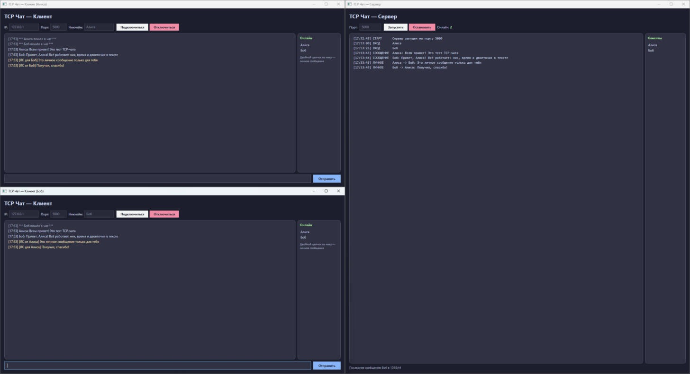

# Многопользовательский TCP-чат

Лабораторная работа №4 по дисциплине «Системное программное обеспечение»  
Многопользовательское приложение для обмена сообщениями в локальной сети 🚀

## Что умеет приложение

- Подключение нескольких клиентов одновременно — каждый в отдельном потоке
- Рассылка сообщений всем участникам чата (broadcast)
- Уведомления о входе и выходе участников
- Список пользователей онлайн в реальном времени
- Личные сообщения (`/pm ник текст`, двойной щелчок по нику в списке)
- Проверка ника: занятый, пустой или с запрещёнными символами — сервер отклоняет подключение
- Корректная обработка внезапного отключения клиента и остановки сервера
- Ограничение длины сообщения (1000 символов), пустые сообщения не отправляются
- Тёмный интерфейс на WPF для сервера и клиента

## Скриншоты



## Как запустить

Готовые программы после сборки: `Server\bin\Debug\net8.0-windows\Server.exe` и `Client\bin\Debug\net8.0-windows\Client.exe`.

1. Открыть `Lab4.slnx` в Visual Studio и собрать решение (Build → Rebuild Solution)
2. Запустить `Server.exe` и нажать **Запустить** (порт 5000)
3. Запустить `Client.exe` несколько раз, в каждом ввести адрес `127.0.0.1`, свой никнейм и нажать **Подключиться**
4. Писать сообщения; для личного сообщения — `/pm ник текст` или двойной щелчок по нику в списке

Для запуска из Visual Studio сразу двух проектов: свойства решения → Multiple startup projects → Server и Client = Start.

## Протокол

Текстовый, построчный: каждая команда или сообщение — одна строка, заканчивающаяся `\n` (читается через `StreamReader.ReadLine()`).

Клиент → сервер:

| Команда | Пример | Описание |
|---------|--------|----------|
| `/join ник` | `/join Алиса` | Первая строка после подключения — регистрация никнейма |
| `/users` | `/users` | Запрос списка пользователей онлайн |
| `/pm ник текст` | `/pm Боб Привет!` | Личное сообщение |
| любой текст | `Всем привет!` | Сообщение в общий чат |

Сервер → клиент:

| Префикс | Формат | Описание |
|---------|--------|----------|
| `MSG:` | `MSG:ник:текст` | Сообщение в общий чат |
| `PM:` | `PM:от_кого:текст` | Входящее личное сообщение |
| `PMTO:` | `PMTO:кому:текст` | Подтверждение отправки личного сообщения |
| `SYS:` | `SYS:текст` | Системное уведомление (вход/выход участника и т. п.) |
| `USERS:` | `USERS:ник1,ник2` | Список пользователей онлайн |
| `ERR:` | `ERR:текст` | Ошибка (ник занят, неверный формат); после неё сервер закрывает соединение |

Ограничения: ник — до 20 символов, без пробелов и символов `: , /`; сообщение — до 1000 символов.

## События сервера

```csharp
public event Action<string> OnClientConnected;          // ник подключившегося
public event Action<string> OnClientDisconnected;       // ник отключившегося
public event Action<string, string> OnMessageReceived;  // отправитель, текст
```

## Структура проекта

```text
TCPChat/
├── Server/
│   ├── ChatServer.cs        логика сервера: TcpListener, поток на клиента, lock, события
│   ├── MainWindow.xaml      интерфейс сервера: лог, счётчик онлайн, список клиентов
│   └── MainWindow.xaml.cs   подписка на события, обновление UI через Dispatcher
├── Client/
│   ├── TcpChatClient.cs     логика клиента: TcpClient, поток чтения, разбор протокола, события
│   ├── MainWindow.xaml      интерфейс клиента: лента, пользователи онлайн, ввод
│   └── MainWindow.xaml.cs   подписка на события, обновление UI через Dispatcher
└── docs/
    └── Отчёт_лаба4.docx
```

## Отчёт

[docs/Отчёт_лаба4.docx](docs/Отчёт_лаба4.docx)

## Технологии

| Технология | Назначение |
|------------|------------|
| C# / .NET 8 | Основной язык разработки |
| WPF | Графический интерфейс |
| System.Net.Sockets | TCP-соединения |
| System.Threading | Потоки и синхронизация |
| Делегаты и события | Оповещение компонентов |
| Dispatcher.Invoke | Обновление UI из потоков |

## Требования

- Visual Studio 2022 или новее (для сборки)
- .NET 8 Desktop Runtime или новее (проекты настроены на запуск и на более новых версиях .NET)
- Windows 10 / Windows 11

## Автор

Ростовцев Д. А.  
Группа Б.ИВТ.ПРОМ.23.01  
Тверской государственный технический университет  
Тверь, 2026 г.
